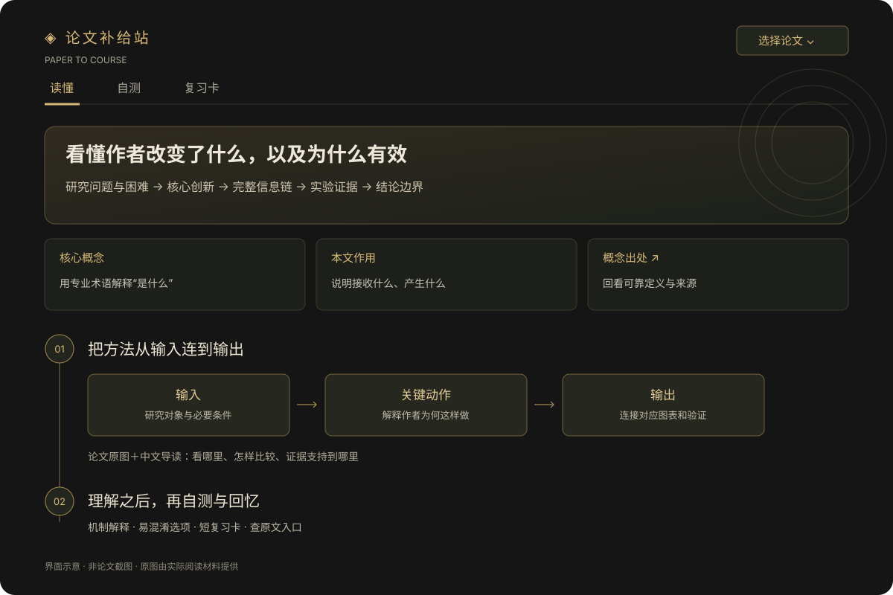

# 论文补给站 · Paper to Course

**把论文组织成能跟着理解的阅读页：概念 → 方法链路 → 原图与证据 → 自测 → 复习卡。**

面向跨专业读论文、刚进入新方向的研究生。将 PDF 或可获取全文的链接交给支持本地 skill 的 AI 助手，生成暗金风格、可离线打开的 HTML 阅读页。



*上图为界面示意。实际解读优先使用用户提供论文中的原图、原表，并给出来源位置。*

## 开始使用

### 1. 安装 skill

在支持 `$skill-installer` 的 Codex 中发送：

```text
用 $skill-installer 安装这个 skill：
https://github.com/haha2006-david/paper-to-course/tree/main/paper-to-course
```

也可以[下载 skill ZIP](https://github.com/haha2006-david/paper-to-course/raw/refs/heads/main/downloads/paper-to-course.zip)，将完整的 `paper-to-course` 文件夹放进宿主的 skills 目录。保留其中的脚本、模板、字体与参考文件，不只复制 `SKILL.md`。

Codex 当前官方文档中的用户级目录是 `~/.agents/skills/`，项目级目录是 `.agents/skills/`；其他客户端或旧版本请以实际发现目录为准。安装后如果列表未更新，可重新启动 Codex。参见[官方技能文档](https://learn.chatgpt.com/docs/build-skills)。

### 2. 给论文，说需求

上传一篇 PDF，然后发送：

```text
用 $paper-to-course 帮我理解这篇论文。
```

已有专业背景时可以直接补充，例如：

```text
我懂机器学习基础，但没接触过模型压缩。
重点讲清创新、方法为什么有效，以及实验到底证明了什么。
```

### 3. 打开阅读页

助手生成可直接打开的 HTML 文件，包含三个入口：

|入口|你可以做什么|
|---|---|
|读懂|先认识必要概念，顺着输入到输出走完方法，对照原图理解证据和局限|
|自测|用容易混淆的选项检查机制理解、读图和结论边界，作答后查看解析|
|复习卡|用问题、方法、证据、边界和回忆一问，重新唤起主线；支持导出 PNG|

正文连续展示。来源详情和复现查阅清单按需展开；主要解释、重要反例不会藏在折叠里。原图支持放大和保存，公式使用内置 KaTeX 与字体，不依赖 CDN。

## 一次给多篇

```text
用 $paper-to-course 处理这次上传的3篇论文，
生成同一批次的阅读页，让我能选择要读哪篇。
```

**上传 n 篇 → 逐篇生成解读 → 从这 n 篇里选择阅读。**

选择列表只包含本批论文，各批次分开保存，各篇自测记录独立。无法读取的文件会说明缺口；不会拿历史样稿替代。移动或分享一批阅读页时，保留同一文件夹中的 HTML 文件，才能继续切换。

## 解读标准

主线固定为：**研究问题与困难 → 核心创新 → 完整信息链 → 证据 → 结论边界**。

- **概念讲具体**：用专业术语解释“是什么、在本文有什么作用”，避免循环定义。
- **方法连起来**：明确输入、关键操作和输出；并行分支标出汇合点，区分训练监督与推理输入。
- **创新对证据**：分清作者新设计与复用组件，保留比较条件、阴性结果、消融和失败案例。
- **图与公式就近解释**：优先实际查看过的原图；必要公式附符号释义，单个等式默认一行，窄屏横向滚动。
- **压缩实际文字**：删冗余，保留理解桥梁；不把一份密集摘要切成许多卡片冒充教学解读。

完整要求见[固定解读标准](paper-to-course/references/understanding-standard.md)。方法论文、实证、理论和综述采用各自合适的论证链，不机械套同一种模型结构。

## 模型、环境与费用

这是一套 **skill、离线阅读器和校验脚本**。论文读取与解读由宿主 AI 助手完成；Python 脚本负责校验和排版，不会自行调用模型，也不会仅凭一份 PDF 自动生成内容。

- 使用宿主提供的模型能力与额度，仓库不提供模型服务，也不收取模型费用。
- HTML 构建和字数审计使用 Python 标准库；建议 Python 3.10+，本地使用 Python 3.13 验证。
- `check_math.py` 需要 Node.js，使用随包内置的 KaTeX 检查公式语法。
- PDF 提取、图片裁剪和必要的 OCR 依赖宿主可用工具，不是阅读器自带的功能。
- 已在本地 Codex 流程中使用；其他宿主的工具权限、发现路径和兼容性需要实际验证。

## 示例与本地构建

[Deep Compression 文字示例](examples/deep-compression.lesson.json)保留了来源、方法、证据与自测。公开示例未附论文原图，因此是有限的文字演示，不能代表带原图的完整交付。

下载仓库后，可直接打开 [`demo/deep-compression.html`](demo/deep-compression.html)，或运行：

```bash
python paper-to-course/scripts/build.py examples/deep-compression.lesson.json --out demo/deep-compression.html
python paper-to-course/scripts/audit_brief.py examples/deep-compression.lesson.json --report audit.json
python paper-to-course/scripts/check_math.py examples/deep-compression.lesson.json
```

一般读者只需让助手使用 skill；这些命令供维护、排错和复用已生成内容。

多篇连接方式和 `lesson.json` 格式见 [format.md](paper-to-course/references/format.md)。

## 已验证与尚未验证

当前规范主要通过 EEG2Video、Deep Compression 等样例及用户反馈迭代。软件检查覆盖内容结构、离线数学字体、公式语法和批次选择等行为；**它们不等于科学内容经过独立专家审查，也不证明学习效果或跨学科普适性**。

只有摘要或关键材料缺失时会生成有限导读。处理时间随论文、可读性和宿主工具而变化，不承诺固定时长；复现、正式引用和关键决策仍需回查原文。

## 开发与反馈

```bash
python -m unittest discover -s tests
python tools/package_skill.py
```

欢迎[提交 Issue](https://github.com/haha2006-david/paper-to-course/issues)。请说明论文的公开标识或可分享片段、哪个解释让你困惑，以及期望看清的关系；不要提交无法公开的论文或敏感数据。

```text
paper-to-course/        可安装的完整 skill
  SKILL.md             触发与执行规则
  references/          解读标准、来源与格式约定
  scripts/             构建、审计、公式检查、批次连接
  assets/              暗金阅读器、离线 KaTeX 与字体
examples/              不含原图的公开文字示例
demo/                  可离线打开的示例 HTML
docs/                  界面示意
downloads/             可直接安装的 skill ZIP
tests/                 软件行为检查
```

## 许可

原创代码、模板与 skill 指令采用 [MIT License](LICENSE)。内置 KaTeX 及字体保留其 [MIT 许可和来源记录](paper-to-course/assets/math/LICENSE)。论文、原图和外部项目的权利归各自作者；本仓库不包含原始论文 PDF，也未将论文原图打包为自由再分发素材。
